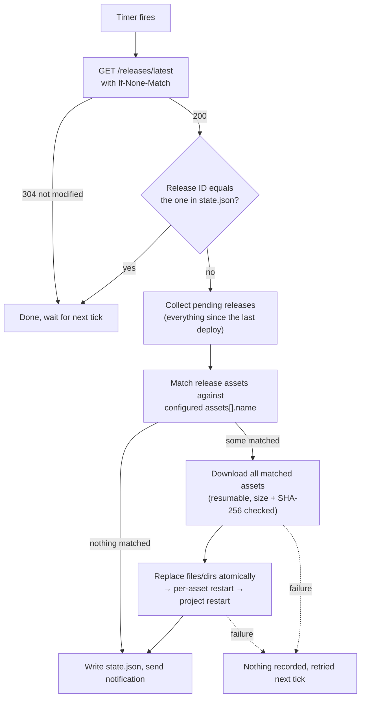

<h1 align="center">bastion-pull</h1>

<p align="center"><b>A tiny pull-based deployer: polls GitHub Releases, replaces files, restarts your service</b></p>

<p align="center">
  <a href="https://github.com/mousehaozi/bastion-pull/actions/workflows/ci.yml"></a>
  <a href="https://github.com/mousehaozi/bastion-pull/releases/latest"></a>
  <a href="https://github.com/mousehaozi/bastion-pull/releases"></a>
  
  
  
  <a href="https://github.com/mousehaozi/bastion-pull/stargazers"></a>
</p>

<p align="center"><a href="README.md">简体中文</a> · English</p>

---

**bastion-pull** is a tiny pull-based deployer. It runs on your server, polls GitHub Releases, and when a new release appears it downloads the assets, replaces the files on disk, and runs your restart command.

It is made for servers that sit behind a bastion host / firewall: it only makes **outbound** HTTPS requests to GitHub. No inbound port, no webhook, no self-hosted runner, no SSH credentials in CI.

Typical flow: *GitHub Actions builds and publishes a Release → bastion-pull notices → replaces files → restarts the service.*

### Features

- Watches many repositories with one process and one config file
- Polls with `ETag` conditional requests: a check with no change returns `304`, which does **not** count against the GitHub API rate limit, so polling every minute is fine
- Resumable downloads with retries; size and SHA-256 are verified before anything is replaced
- Replaces files atomically (single file: write + rename; directory: unpack to a staging dir, then swap)
- Remembers the deployed release, so restarting bastion-pull never redeploys
- If anything fails (download, replace, restart), nothing is marked as deployed and the next tick retries
- Static binary, no dependencies. Linux builds for amd64, arm64, armv7, 386, riscv64, loong64, mips64le
- Honors `HTTPS_PROXY` / `NO_PROXY`
- Optional update notifications through [PushPlus](https://www.pushplus.plus) to one or more groups and/or friends, or by SMTP email to several recipients

### How it works

For every project, bastion-pull runs this loop:



1. **Poll:** ask GitHub for the *latest release*, sending the previous `ETag`. With no new release GitHub answers `304`, which does not count against the rate limit.
2. **Already deployed?** Compare the release ID with the one in `state.json`; if equal, skip (so restarting bastion-pull never redeploys).
3. **Collect pending releases:** every published release (no drafts, no pre-releases, looking at the 30 most recent) newer than the last deployed one, oldest first. On the very first run (no state) only the latest is used.
4. **Match by name:** for each configured asset, search the pending releases from newest to oldest for an asset whose file name matches:
   - found → this asset is updated (from the newest release carrying it);
   - not found → left untouched this time;
   - several matches in one release → error, the project is not deployed this time.

   Release assets that no config entry matches (e.g. `checksums.txt`) are ignored.
5. **Download first, replace later:** every asset is downloaded and verified before any live file is touched, so you never end up half old, half new because of a download error.
6. **Replace and restart:** replace each file/directory, run the `restart` of every updated asset (each distinct command once), then the project-level `restart`.
7. **Record:** only when everything succeeded is the latest release written to `state.json` and the notification sent. Any failure records nothing and the next tick starts again from step 3.

Example: `build-1` was deployed; between two checks `build-2` (with `web.tar.gz` and `api`) and `build-3` (only `web.tar.gz`) were published. bastion-pull merges them: `web.tar.gz` comes from `build-3`, `api` from `build-2`, only those two assets' services are restarted, and `build-3` is recorded as deployed.

### Quick install (recommended)

On the server, as root:

```bash
curl -fsSL https://raw.githubusercontent.com/mousehaozi/bastion-pull/main/install.sh | sudo bash
```

The script:

1. detects the CPU architecture (amd64, arm64, armv7, 386, riscv64, loong64, mips64le),
2. downloads the matching binary from the latest release and verifies its SHA-256,
3. installs it to `/usr/local/bin/bastion-pull`, so the `bastion-pull` command works globally,
4. creates the default config `/etc/bastion-pull/config.yaml` (mode 600) if it does not exist yet; an existing config is never overwritten,
5. registers the `bastion-pull` systemd service, **enabled at boot** and with `Restart=always`, so it starts after a server reboot and restarts after a crash,
6. prints where the config file is and what to do next.

After it finishes you **must fill in the config file**, then start the service:

```bash
sudo vi /etc/bastion-pull/config.yaml                       # token, repo, assets, restart command
sudo bastion-pull -c /etc/bastion-pull/config.yaml -once    # optional: test once in the foreground
sudo systemctl start bastion-pull
journalctl -u bastion-pull -f
```

The service is not started on a fresh install because the default config is only a template. Running the script again later **upgrades** the binary, keeps your config, and restarts the service.

Options and environment variables:

| | |
|---|---|
| `--version <tag>` | Install a specific release instead of the latest |
| `--file <archive.tar.gz>` | Install from a local archive (offline; if `checksums.txt` sits next to it, it is verified) |
| `--uninstall` | Remove the binary and the service, keep `/etc/bastion-pull` |
| `GH_PROXY=https://ghfast.top/` | Prefix for GitHub URLs, for servers with a poor connection to GitHub |

If `raw.githubusercontent.com` is blocked (`Connection reset by peer`), fetch the script through a mirror, or skip it and use the offline method below:

```bash
curl -fsSL https://ghfast.top/https://raw.githubusercontent.com/mousehaozi/bastion-pull/main/install.sh | sudo env GH_PROXY=https://ghfast.top/ bash
```

If the server cannot reach GitHub, download `bastion-pull_<version>_linux_<arch>.tar.gz` and `checksums.txt` on another machine, copy them over, and run `sudo ./install.sh --file bastion-pull_<version>_linux_<arch>.tar.gz` (`install.sh` is also inside the archive).

### Manual install

1. Download the archive for your CPU from the [Releases](../../releases) page and verify it against `checksums.txt`:

   ```bash
   uname -m        # x86_64 → linux_amd64, aarch64 → linux_arm64, armv7l → linux_armv7
   sha256sum -c checksums.txt --ignore-missing
   tar xzf bastion-pull_*_linux_amd64.tar.gz
   sudo install -m 755 bastion-pull_*_linux_amd64/bastion-pull /usr/local/bin/bastion-pull
   bastion-pull -version
   ```

2. Create a GitHub token (see [Token](#token)) and the config file:

   ```bash
   sudo mkdir -p /etc/bastion-pull
   sudo cp config.example.yaml /etc/bastion-pull/config.yaml
   sudo chmod 600 /etc/bastion-pull/config.yaml
   sudo vi /etc/bastion-pull/config.yaml
   ```

3. Try it once in the foreground:

   ```bash
   sudo bastion-pull -c /etc/bastion-pull/config.yaml -once
   ```

4. Run it as a service:

   ```bash
   sudo cp deploy/bastion-pull.service /etc/systemd/system/
   sudo systemctl daemon-reload
   sudo systemctl enable --now bastion-pull
   journalctl -u bastion-pull -f
   ```

Run it as the user that is allowed to write the target paths and run the restart command (usually `root`). When it runs as root, replaced files keep the owner of the files they replace.

### Token

Only needed for private repositories, but strongly recommended anyway (unauthenticated requests have a very low rate limit).

GitHub → Settings → Developer settings → Personal access tokens → **Fine-grained tokens** → Generate:

- Repository access: *Only select repositories* → the repos you deploy
- Permissions → Repository permissions → **Contents: Read-only** (that is all)
- Set an expiry you can live with and remember to renew it. A `401` in the log means the token has expired.

Put it in the config (`token:`) or in the `GITHUB_TOKEN` environment variable.

### Configuration

```yaml
token: github_pat_xxx          # or env GITHUB_TOKEN
interval: 60s                  # default 1m, minimum 10s
# state_file: /var/lib/bastion-pull/state.json   # default: state.json next to the config
# api_url: https://api.github.com                # only change for GitHub Enterprise

projects:
  - name: studio                       # optional, for logs
    repo: owner/name
    assets:
      - name: web.tar.gz               # unpack into a directory
        extract_to: /var/www/site
      - name: app-*.jar                # glob allowed, must match exactly one asset
        copy_to: /opt/app/app.jar      # copy a single file
        mode: "0644"                   # optional, default: keep the existing file's mode
    restart: systemctl restart app     # optional, run with `sh -c` after all assets are replaced
```

| Key | Meaning |
|---|---|
| `token` | GitHub token. Falls back to `$GITHUB_TOKEN`. |
| `interval` | Time between checks. |
| `state_file` | JSON file recording the deployed release of every repo. A `downloads/` folder for partial downloads is created beside it. |
| `projects[].repo` | `owner/name`. Each repo may appear once. |
| `projects[].assets[].name` | Release asset file name or glob (`*`, `?`, `[a-z]`). Several matches in one release is an error; no match just means this release does not update it. |
| `extract_to` | Directory to unpack `.tar.gz` / `.tgz` / `.zip` into. The directory is **replaced as a whole** (old files disappear). Its parent must be writable. |
| `copy_to` | Destination file path (parent directories are created). |
| `projects[].restart` | Shell command run once after all assets of the project were replaced. A non-zero exit counts as failure and is retried next tick. |
| `projects[].assets[].restart` | Shell command run only when **this** asset was updated (once per distinct command), before the project-level `restart`. Use it to restart just the service that changed. |

**Matching drives everything.** A release only needs to carry the assets that changed (e.g. your Actions workflow only builds the admin app this time). For each release, bastion-pull matches its assets against the configured `assets[].name`; every match runs its action (unpack / copy, then its own `restart`), and configured assets the release does not carry are simply skipped. The project-level `restart` runs only if at least one asset matched. A release matching nothing is recorded and ignored. If several releases appeared since the last check, they are merged (the newest one carrying an asset wins), so quick successive releases never lose an update.

Exactly one of `extract_to` / `copy_to` is required per asset. Unknown keys are rejected so typos do not go unnoticed.

Command line:

```
bastion-pull [-c config.yaml] [-once] [-notify-test] [-notify-latest] [-version]
```

`-once` checks every project once and exits (exit code 1 if something failed), handy for testing or cron.

### Update notifications (PushPlus)

After a project has been deployed successfully (files replaced and restart command finished), bastion-pull can send a short HTML message: project, version, time, server, a brief changelog and the updated files. The HTML template is compiled into the binary.

```yaml
notify:
  pushplus:
    token: your_pushplus_token          # or env PUSHPLUS_TOKEN
    # channel: wechat                   # optional, default wechat
    targets:                            # one or more; none = only the token owner
      - name: dev-group
        topic: your_group_code          # send to a group (group code)
      - name: ops
        to: friend_token_1,friend_token_2   # send to friends (comma separated or a YAML list)
      - name: me                        # neither topic nor to = yourself
```

- Get the token on the PushPlus site (*Send message → token*). Group codes are created under *Group message*; friend tokens come from *Friends*.
- Each target is one request. A target uses **either** `topic` **or** `to` (PushPlus ignores `to` when a group is given), so list a group and some friends as separate targets. At most 100 friend tokens per target (PushPlus limits non-members to 10).
- Set `notify: false` on a project to silence it. An empty `token` disables notifications (a warning is logged) instead of failing.
- The "changelog" is taken from the GitHub Release notes (the first 8 lines, markdown stripped). In your release workflow, put the commit messages into the notes, for example:

  ```yaml
  - run: |
      jq -r '.commits[]?.message | split("\n")[0] | "- " + .' "$GITHUB_EVENT_PATH" > notes.md
      [ -s notes.md ] || echo "- manual build" > notes.md
      gh release create "$TAG" web.tar.gz app.jar --notes-file notes.md
  ```

- A failed notification is logged (`notification failed`) and retried 3 times, but never fails or repeats the deployment. Failed deployments do not send a message.
- Test your settings at any time, without deploying anything and while the service is running (without `-c`, `/etc/bastion-pull/config.yaml` is used):

  ```bash
  sudo bastion-pull -notify-test      # a dummy message
  sudo bastion-pull -notify-latest    # the real message for each project's latest release, titled "【测试】"
  ```

### Email notifications (SMTP)

Notifications can also (or only) go out over SMTP, with the same content as PushPlus. One message is sent to all recipients in `to`.

```yaml
notify:
  email:
    host: smtp.qiye.aliyun.com
    port: 465                           # optional; default 465 for ssl, 587 for starttls, 25 for none
    # security: ssl                     # ssl | starttls | none; default: ssl on port 465, otherwise starttls
    username: notification@mouse.asia   # empty = no authentication
    password: ""                        # authorization code, or env SMTP_PASSWORD
    from: "Bastion <notification@mouse.asia>"  # optional, defaults to username
    to:                                 # one or more recipients (or a comma separated string)
      - dev@example.com
      - ops@example.com
```

- `pushplus` and `email` can both be configured; every configured channel sends. `notify: false` on a project silences both.
- An invalid email config (missing `host` or `to`, malformed address, ...) makes the program refuse to start with a message.
- `-notify-test` / `-notify-latest` send emails too.

### Behavior notes

- **First run:** with no state recorded, the current latest release is deployed immediately.
- **What counts as "latest":** GitHub's *latest release*, i.e. the newest published release that is neither a draft nor a pre-release.
- **Rollback:** there is none, by design. To roll back, publish a new release (or re-run an old build so it becomes the newest release).
- **Directory swap:** replacing a directory is two quick renames, so there is a few-millisecond window where the path does not exist. `extract_to` cannot be a mount point or a symlink target on another filesystem.
- **Several instances:** a lock file (`<state_file>.lock`) prevents two instances sharing one state file.
- **Logs:** printed to stdout/stderr, so `journalctl -u bastion-pull` shows them.

### Publishing from GitHub Actions

bastion-pull only looks at **asset file names** in a release, so the workflow and the server config have to agree on them.

#### Asset naming rules

1. **Use fixed file names; keep versions out of them.** The version already lives in the release tag. Use `app.jar`, `web.tar.gz` — not `app-1.4.2.jar`. If your build tool adds a version, rename the file in the workflow:

   ```bash
   cp target/myapp-*.jar out/app.jar
   ```

2. **If you do use a glob, make sure it matches exactly one file per release.** `app-*.jar` matches both `app-1.0.jar` and `app-1.0-sources.jar`, which is a `matches 2 assets` error and the project is not deployed. Globs support `*`, `?`, `[a-z]` and are case sensitive.
3. **Names of different programs must not overlap.** Use e.g. `web.tar.gz` and `admin.tar.gz`; do not write a pattern like `*.tar.gz` that matches both.
4. **The extension decides the handling:** `extract_to` accepts only `.tar.gz`, `.tgz`, `.zip`; `copy_to` copies any file as is.
5. **Archive a directory's *contents*** so the files land directly in `extract_to`: `tar -czf web.tar.gz -C dist .`
6. Publish **regular** releases: drafts and pre-releases (`--prerelease`) are never deployed.

How workflow file names map to the config:

| Uploaded by the workflow | Config `assets[].name` | Action |
|---|---|---|
| `out/web.tar.gz` | `web.tar.gz` | `extract_to: /var/www/site` |
| `out/admin.tar.gz` | `admin.tar.gz` | `extract_to: /var/www/admin` |
| `out/api` | `api` | `copy_to: /opt/shop/api` |

#### Single-program repository

Build and publish on every push:

```yaml
- run: |
    mkdir -p out && cp target/myapp-*.jar out/app.jar
    gh release create "build-$(date -u +%Y%m%d-%H%M%S)-${GITHUB_SHA::7}" out/app.jar --generate-notes
  env:
    GH_TOKEN: ${{ github.token }}
```

#### Monorepo: build and update only what changed

The idea: the workflow looks at which directories the push touched, **builds only those programs**, and the release **carries only their outputs**. On the server one config lists every program; whatever the release carries is updated and restarted, everything else is left alone.

Assume this layout (`packages/shared` is used by both front-ends):

```
apps/web/        → web.tar.gz    → /var/www/shop          (static files, no restart)
apps/admin/      → admin.tar.gz  → /var/www/shop-admin    (nginx reload)
services/api/    → api           → /opt/shop/api          (systemctl restart shop-api)
packages/shared/ → when it changes, rebuild both web and admin
```

`.github/workflows/release.yml`:

```yaml
name: Release

on:
  push:
    branches: [main]
  workflow_dispatch:          # manual run = rebuild everything

permissions:
  contents: write

concurrency:                  # publish one at a time so release order follows commit order
  group: release
  cancel-in-progress: false

jobs:
  release:
    runs-on: ubuntu-latest
    steps:
      - uses: actions/checkout@v4
        with:
          fetch-depth: 0      # full history, needed for the diff

      - name: Detect changes
        id: changes
        run: |
          before="${{ github.event.before }}"
          # manual run, new branch, or force push (old commit gone) → build everything
          if [ "$GITHUB_EVENT_NAME" != push ] || [ -z "$before" ] \
             || [ "$before" = 0000000000000000000000000000000000000000 ] \
             || ! git cat-file -e "$before^{commit}" 2>/dev/null; then
            files=ALL
          else
            files=$(git diff --name-only "$before" "$GITHUB_SHA")
          fi
          echo "$files"
          changed() { [ "$files" = ALL ] || grep -qE "$1" <<<"$files"; }
          if changed '^(apps/web|packages/shared)/';   then echo web=true   >> "$GITHUB_OUTPUT"; fi
          if changed '^(apps/admin|packages/shared)/'; then echo admin=true >> "$GITHUB_OUTPUT"; fi
          if changed '^services/api/';                 then echo api=true   >> "$GITHUB_OUTPUT"; fi
          mkdir -p out

      # replace the build commands below with your own
      - name: Build web
        if: steps.changes.outputs.web == 'true'
        run: |
          npm ci && npm run build -w apps/web
          tar -czf out/web.tar.gz -C apps/web/dist .

      - name: Build admin
        if: steps.changes.outputs.admin == 'true'
        run: |
          npm ci && npm run build -w apps/admin
          tar -czf out/admin.tar.gz -C apps/admin/dist .

      - uses: actions/setup-go@v5
        if: steps.changes.outputs.api == 'true'
        with:
          go-version-file: services/api/go.mod
      - name: Build api
        if: steps.changes.outputs.api == 'true'
        working-directory: services/api
        run: CGO_ENABLED=0 GOOS=linux GOARCH=amd64 go build -trimpath -o ../../out/api .

      - name: Publish release
        env:
          GH_TOKEN: ${{ github.token }}
        run: |
          shopt -s nullglob
          assets=(out/*)
          if [ ${#assets[@]} -eq 0 ]; then
            echo "nothing changed, no release"; exit 0
          fi
          tag="build-$(date -u +%Y%m%d-%H%M%S)-${GITHUB_SHA::7}"
          # commit subjects as release notes (shown in update notifications)
          jq -r '.commits[]?.message | split("\n")[0] | "- " + .' "$GITHUB_EVENT_PATH" > notes.md || true
          [ -s notes.md ] || echo "- manual build" > notes.md
          gh release create "$tag" "${assets[@]}" --title "$tag" --notes-file notes.md --target "$GITHUB_SHA"
```

Server config (one project per repository, listing every program):

```yaml
projects:
  - name: shop
    repo: acme/shop
    assets:
      - name: web.tar.gz
        extract_to: /var/www/shop                # static files, no restart needed
      - name: admin.tar.gz
        extract_to: /var/www/shop-admin
        restart: nginx -s reload
      - name: api
        copy_to: /opt/shop/api
        mode: "0755"
        restart: systemctl restart shop-api      # runs only when api was updated
```

Result:

| The push changed | Assets in the release | What happens on the server |
|---|---|---|
| `apps/web/**` | `web.tar.gz` | only `/var/www/shop` is replaced |
| `services/api/**` | `api` | only `/opt/shop/api` is replaced, then `systemctl restart shop-api` |
| `packages/shared/**` | `web.tar.gz`, `admin.tar.gz` | both front-end directories replaced, `nginx -s reload` runs once |
| only `README.md` | (no release) | nothing |
| manual workflow run | all | everything replaced and restarted |

Notes:

- **Do not restart individual services in the project-level `restart`.** It runs whenever *any* asset was updated; to restart only what changed, put the command on the asset.
- **Re-run failed builds.** Each push builds only what changed since the previous push. If a run fails, use **Re-run** on that run in the Actions tab (it reuses the same push event, so the diff is the same), or trigger the workflow manually for a full build — otherwise that push's changes are never released.
- **Quick successive releases are safe.** Several releases published between two checks are merged (see [How it works](#how-it-works)), as long as they are not deleted before being deployed and no more than 30 pile up.
- Cleaning up old releases (e.g. keeping the last N) is fine as long as you only delete ones that were already deployed.

### Troubleshooting

| Log message | Cause |
|---|---|
| `404: no published release, or the token cannot see this repository` | No release yet, only drafts/pre-releases exist, wrong repo name, or the token has no access to the repo. |
| `401: token is invalid or expired` | Renew the token. |
| `pattern "x" matches N assets, make it more specific` | A glob matches several files in one release, see [Asset naming rules](#asset-naming-rules). |
| `release carries none of the configured assets, nothing to deploy` | No file in the release matches the config (not an error). Check that the workflow uploads the names used in `assets[].name`. |
| `download … failed after 8 attempts` | Network to GitHub is bad. Partial files are kept and resumed on the next tick. Try setting `HTTPS_PROXY`. |
| `restart command: exit status N` | Your restart command failed; the whole project is retried next tick. |

### Build from source

```bash
go test ./...
CGO_ENABLED=0 GOOS=linux GOARCH=arm64 go build -trimpath -ldflags "-s -w -X main.version=dev" -o bastion-pull .
```

Every push to `main` is tested, cross-compiled and published as a release named `build-<time>-<sha>` (the 10 newest are kept). Pushing a tag such as `v1.0.0` publishes a release with that name.
