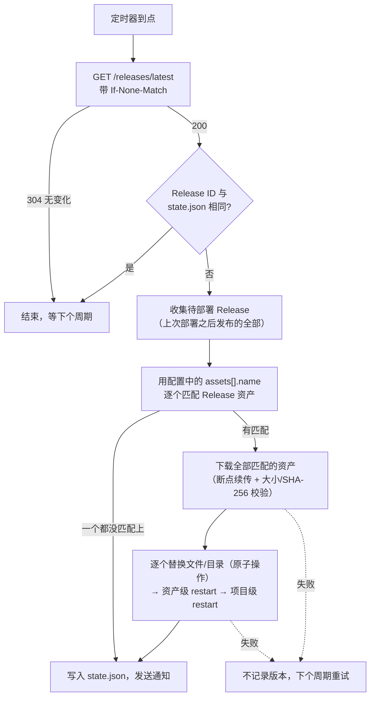

<h1 align="center">bastion-pull</h1>

<p align="center"><b>拉取式部署工具：定时检查 GitHub Release，自动替换文件并重启服务</b></p>

<p align="center">
  <a href="https://github.com/mousehaozi/bastion-pull/actions/workflows/ci.yml"></a>
  <a href="https://github.com/mousehaozi/bastion-pull/releases/latest"></a>
  <a href="https://github.com/mousehaozi/bastion-pull/releases"></a>
  
  
  
  <a href="https://github.com/mousehaozi/bastion-pull/stargazers"></a>
</p>

<p align="center">简体中文 · <a href="README.en.md">English</a></p>

---

**bastion-pull** 是一个很小的「拉取式」部署工具。它运行在你的服务器上，定时检查 GitHub Release，发现新版本就下载资产、替换磁盘上的文件，再执行你配置的重启命令。

适合部署在堡垒机 / 防火墙后面的服务器：它只会主动向 GitHub 发起**出站** HTTPS 请求，不需要开放入站端口，不需要 Webhook，不需要 self-hosted runner，CI 里也不用保存服务器的 SSH 凭证。

典型流程：*GitHub Actions 构建并发布 Release → bastion-pull 发现新版本 → 替换文件 → 重启服务。*

### 特性

- 一个进程、一份配置，同时监控多个仓库
- 使用 `ETag` 条件请求轮询：没有更新时 GitHub 返回 `304`，**不消耗** API 限额，所以每分钟检查一次完全没问题
- 下载支持断点续传和重试；替换前校验文件大小和 SHA-256
- 原子替换（单文件：写临时文件再 rename；目录：先解压到临时目录再整体切换）
- 记录已部署的版本，bastion-pull 自身重启不会重复部署
- 任何一步失败（下载、替换、重启）都不会记为已部署，下个周期自动重试
- 静态二进制，无依赖。提供 amd64、arm64、armv7、386、riscv64、loong64、mips64le 的 Linux 版本
- 支持 `HTTPS_PROXY` / `NO_PROXY` 环境变量
- 可选的更新通知：通过 [PushPlus（推送加）](https://www.pushplus.plus) 推送给一个或多个群组 / 好友，或通过 SMTP 发邮件给多个收件人

### 工作原理

bastion-pull 对每个项目周期性地执行下面的流程：



1. **轮询：** 带上次的 `ETag` 请求 GitHub 的 *latest release*。没有新 Release 时返回 `304`，不消耗 API 限额。
2. **判断是否已部署：** 拿 Release ID 和 `state.json` 里记录的比较，相同就跳过（所以 bastion-pull 自己重启后不会重复部署）。
3. **收集待部署的 Release：** 取出上次部署之后发布的**所有**正式 Release（不含草稿和预发布，最多看最近 30 个），按发布顺序排列。首次运行（没有记录）时只看最新的那个。
4. **按名称匹配：** 对配置里的每个资产，从最新的 Release 往旧的找第一个文件名匹配的资产：
   - 找到 → 这个资产本次要更新（用最新的那份）；
   - 都找不到 → 本次不动它，旧文件原样保留；
   - 同一个 Release 里匹配到多个 → 报错，整个项目本次不部署。

   Release 中没有被任何配置匹配上的资产（例如 `checksums.txt`）会被忽略。
5. **先下载，后替换：** 所有要更新的资产全部下载并校验完，才开始碰线上文件，避免「下载到一半，一半新一半旧」。
6. **替换并重启：** 依次替换文件/目录；然后执行被更新资产各自的 `restart`（相同命令只执行一次），最后执行项目级 `restart`。
7. **记录：** 全部成功后才把最新 Release 记入 `state.json` 并发送通知。中间任何一步失败都不记录，下个周期从第 3 步重新来过。

举个例子：上次部署的是 `build-1`；在两次检查之间先后出现了 `build-2`（含 `web.tar.gz`、`api`）和 `build-3`（只含 `web.tar.gz`）。bastion-pull 会合并处理：`web.tar.gz` 取自 `build-3`，`api` 取自 `build-2`，只重启这两个资产对应的服务，然后记录为已部署 `build-3`。

### 一键安装（推荐）

在服务器上用 root 执行：

```bash
curl -fsSL https://raw.githubusercontent.com/mousehaozi/bastion-pull/main/install.sh | sudo bash
```

脚本会依次完成：

1. 检测 CPU 架构（amd64、arm64、armv7、386、riscv64、loong64、mips64le）；
2. 从最新 Release 下载对应架构的二进制，并校验 SHA-256；
3. 安装到 `/usr/local/bin/bastion-pull`，之后可在任意位置直接使用 `bastion-pull` 命令；
4. 如果 `/etc/bastion-pull/config.yaml` 不存在，则创建默认配置（权限 600）；已有配置绝不会被覆盖；
5. 注册 `bastion-pull` 的 systemd 服务，**设置开机自启**并配置 `Restart=always`：服务器重启后自动启动，进程异常退出后自动重启；
6. 输出配置文件的位置和下一步要做的事。

脚本执行完后，你**必须先填写配置文件**，再启动服务：

```bash
sudo vi /etc/bastion-pull/config.yaml                       # 填写 token、仓库、资产路径、重启命令
sudo bastion-pull -c /etc/bastion-pull/config.yaml -once    # 可选：前台试跑一次
sudo systemctl start bastion-pull
journalctl -u bastion-pull -f
```

首次安装不会自动启动服务，因为默认配置只是模板。以后再次运行该脚本即为**升级**：替换程序、保留你的配置、并自动重启服务。

参数与环境变量：

| | |
|---|---|
| `--version <tag>` | 安装指定版本，默认最新 |
| `--file <archive.tar.gz>` | 使用本地压缩包安装（离线；压缩包旁有 `checksums.txt` 时会校验） |
| `--uninstall` | 卸载程序和服务，保留 `/etc/bastion-pull` |
| `GH_PROXY=https://ghfast.top/` | GitHub 地址前缀，用于访问 GitHub 较慢的服务器 |

如果 `raw.githubusercontent.com` 被屏蔽（`Connection reset by peer`），可以通过镜像获取脚本，或直接用下面的离线方式：

```bash
curl -fsSL https://ghfast.top/https://raw.githubusercontent.com/mousehaozi/bastion-pull/main/install.sh | sudo env GH_PROXY=https://ghfast.top/ bash
```

如果服务器连不上 GitHub，可以在别的机器上下载 `bastion-pull_<版本>_linux_<架构>.tar.gz` 和 `checksums.txt`，拷贝到服务器后执行 `sudo ./install.sh --file bastion-pull_<版本>_linux_<架构>.tar.gz`（压缩包里也带有 `install.sh`）。

### 手动安装

1. 到 [Releases](../../releases) 页面下载对应 CPU 架构的压缩包，并用 `checksums.txt` 校验：

   ```bash
   uname -m        # x86_64 → linux_amd64，aarch64 → linux_arm64，armv7l → linux_armv7
   sha256sum -c checksums.txt --ignore-missing
   tar xzf bastion-pull_*_linux_amd64.tar.gz
   sudo install -m 755 bastion-pull_*_linux_amd64/bastion-pull /usr/local/bin/bastion-pull
   bastion-pull -version
   ```

2. 创建 GitHub 令牌（见下文[令牌](#令牌)）并写配置文件：

   ```bash
   sudo mkdir -p /etc/bastion-pull
   sudo cp config.example.yaml /etc/bastion-pull/config.yaml
   sudo chmod 600 /etc/bastion-pull/config.yaml
   sudo vi /etc/bastion-pull/config.yaml
   ```

3. 先前台试跑一次：

   ```bash
   sudo bastion-pull -c /etc/bastion-pull/config.yaml -once
   ```

4. 注册为系统服务：

   ```bash
   sudo cp deploy/bastion-pull.service /etc/systemd/system/
   sudo systemctl daemon-reload
   sudo systemctl enable --now bastion-pull
   journalctl -u bastion-pull -f
   ```

请用有权限写入目标路径、执行重启命令的用户运行（通常是 `root`）。以 root 运行时，被替换的文件会保持原来的属主。

### 令牌

私有仓库必须配置；公开仓库也强烈建议配置（未认证请求的限额非常低）。

GitHub → Settings → Developer settings → Personal access tokens → **Fine-grained tokens** → Generate：

- Repository access：选 *Only select repositories*，只勾选要部署的仓库
- Permissions → Repository permissions → **Contents: Read-only**（只需要这一项）
- 设置一个你能接受的有效期，并记得到期续期。日志里出现 `401` 说明令牌过期了。

令牌可以写在配置的 `token:` 里，也可以用环境变量 `GITHUB_TOKEN`。

### 配置

```yaml
token: github_pat_xxx          # 或环境变量 GITHUB_TOKEN
interval: 60s                  # 默认 1m，最小 10s
# state_file: /var/lib/bastion-pull/state.json   # 默认：配置文件同目录的 state.json
# api_url: https://api.github.com                # 仅 GitHub Enterprise 需要修改

projects:
  - name: studio                       # 可选，仅用于日志
    repo: owner/name
    assets:
      - name: web.tar.gz               # 解压到目录
        extract_to: /var/www/site
      - name: app-*.jar                # 支持通配符，必须恰好匹配一个资产
        copy_to: /opt/app/app.jar      # 复制单个文件
        mode: "0644"                   # 可选，默认沿用原文件权限
    restart: systemctl restart app     # 可选，所有资产替换完后用 `sh -c` 执行
```

| 配置项 | 说明 |
|---|---|
| `token` | GitHub 令牌，未填时读取 `$GITHUB_TOKEN`。 |
| `interval` | 检查间隔。 |
| `state_file` | 记录各仓库已部署版本的 JSON 文件；未下载完的文件放在它旁边的 `downloads/` 目录。 |
| `projects[].repo` | `owner/name`，同一个仓库只能出现一次。 |
| `projects[].assets[].name` | Release 资产文件名或通配符（`*`、`?`、`[a-z]`）。同一个 Release 里匹配到多个会报错；匹配不到只表示这次 Release 不更新它。 |
| `extract_to` | 把 `.tar.gz` / `.tgz` / `.zip` 解压到的目录。目录会被**整体替换**（旧文件会消失），其上级目录需要可写。 |
| `copy_to` | 目标文件路径（自动创建上级目录）。 |
| `projects[].restart` | 该项目所有资产替换完成后执行一次的 shell 命令。退出码非 0 视为失败，下个周期重试。 |
| `projects[].assets[].restart` | 只有**这个资产**被更新时才执行的 shell 命令（相同命令只执行一次），先于项目级 `restart` 执行。用来只重启发生变化的那个服务。 |

**一切由匹配驱动。** Release 里只需要带有变化的资产（比如这次 Actions 只编译了管理端）。bastion-pull 会把 Release 的资产和配置里的 `assets[].name` 逐个匹配：匹配上的就执行对应动作（解压/复制，再执行它自己的 `restart`），配置了但这次 Release 里没有的资产直接跳过。项目级 `restart` 只在至少有一个资产匹配时才执行；一个都没匹配上，只记录版本、不做任何事。如果两次检查之间出现了多个 Release，会合并处理（同一资产取最新的），连续发布也不会漏掉更新。

每个资产必须且只能配置 `extract_to` 或 `copy_to` 其中之一。出现未知配置项会直接报错，避免拼写错误被忽略。

命令行：

```
bastion-pull [-c config.yaml] [-once] [-notify-test] [-notify-latest] [-version]
```

`-once` 表示每个项目只检查一次就退出（有失败时退出码为 1），方便测试或配合 cron。

### 更新通知（PushPlus 推送加）

项目部署成功（文件已替换、重启命令已执行完）后，bastion-pull 可以发送一条简洁的 HTML 消息：项目名、版本、时间、服务器、简要更新日志和已更新的文件。HTML 模板已编译在程序里。

```yaml
notify:
  pushplus:
    token: your_pushplus_token          # 或环境变量 PUSHPLUS_TOKEN
    # channel: wechat                   # 可选，默认 wechat
    targets:                            # 可配置一个或多个；不配置则只发给 token 所有者
      - name: dev-group
        topic: your_group_code          # 发送到群组（填群组编码）
      - name: ops
        to: friend_token_1,friend_token_2   # 发送给好友（逗号分隔，或写成 YAML 列表）
      - name: me                        # topic 和 to 都不填 = 发给自己
```

- token 在 PushPlus 官网获取（*发送消息 → token*）；群组编码在*群组消息*里创建；好友令牌在*好友*里获取。
- 每个发送对象对应一次请求。一个对象只能选 `topic` **或** `to`（填了群组时 PushPlus 会忽略 `to`），所以群组和好友请分开写成不同的对象。每个对象最多 100 个好友令牌（PushPlus 对非会员限制为 10 个）。
- 在某个项目下写 `notify: false` 可关闭该项目的通知。`token` 留空则整体关闭通知（日志里会有警告），不会导致程序报错。
- 「更新日志」来自 GitHub Release 的说明（取前 8 行，去掉 Markdown 标记）。请在发布流程里把提交信息写进说明，例如：

  ```yaml
  - run: |
      jq -r '.commits[]?.message | split("\n")[0] | "- " + .' "$GITHUB_EVENT_PATH" > notes.md
      [ -s notes.md ] || echo "- manual build" > notes.md
      gh release create "$TAG" web.tar.gz app.jar --notes-file notes.md
  ```

- 通知失败只会记录日志（`notification failed`）并重试 3 次，不会导致部署失败，也不会重复部署。部署失败时不发送消息。
- 随时可以测试通知，不会部署任何东西，服务运行时也能执行（不写 `-c` 时默认使用 `/etc/bastion-pull/config.yaml`）：

  ```bash
  sudo bastion-pull -notify-test      # 发一条模拟消息
  sudo bastion-pull -notify-latest    # 用各项目最新 Release 的真实内容发一条，标题带「【测试】」
  ```

### 邮件通知（SMTP）

也可以（或同时）通过 SMTP 发邮件，内容与 PushPlus 相同。一封邮件会同时发给 `to` 里的所有收件人。

```yaml
notify:
  email:
    host: smtp.qiye.aliyun.com
    port: 465                           # 可选；ssl 默认 465，starttls 默认 587，none 默认 25
    # security: ssl                     # ssl | starttls | none；默认：端口 465 用 ssl，否则 starttls
    username: notification@mouse.asia   # 留空则不认证
    password: ""                        # 授权码，或环境变量 SMTP_PASSWORD
    from: "Bastion <notification@mouse.asia>"  # 可选，默认用 username
    to:                                 # 一个或多个收件人（也可写成逗号分隔的字符串）
      - dev@example.com
      - ops@example.com
```

- `pushplus` 和 `email` 可以同时配置，两个渠道都会发送；项目下的 `notify: false` 对两者都生效。
- 邮件配置有误（缺少 `host`、`to`，地址格式错误等）时程序会启动失败并给出提示。
- `-notify-test` / `-notify-latest` 同样会发邮件。

### 行为说明

- **首次运行：** 没有记录时，会立即部署当前最新的 Release。
- **「最新」的定义：** GitHub 的 *latest release*，即最近发布的、非草稿也非预发布的 Release。
- **回滚：** 按设计没有回滚功能。需要回滚时，重新发布一个新的 Release（或重跑旧的构建，让它成为最新的 Release）。
- **目录切换：** 替换目录是两次快速的 rename，期间有几毫秒该路径不存在。`extract_to` 不能是挂载点。
- **多实例：** 通过锁文件（`<state_file>.lock`）防止两个实例共用同一个状态文件。
- **日志：** 输出到标准输出/错误，用 `journalctl -u bastion-pull` 查看。

### 在 GitHub Actions 中发布

bastion-pull 只认 Release 里的**资产文件名**，所以发布端和服务器端要约定好名字。

#### 资产命名规则

1. **用固定的文件名，不要把版本号写进文件名。** 版本已经体现在 Release 的标签上了。写 `app.jar`、`web.tar.gz`，不要写 `app-1.4.2.jar`。如果构建工具产出的文件名带版本号，在 workflow 里改名即可：

   ```bash
   cp target/myapp-*.jar out/app.jar
   ```

2. **一定要用通配符时，确保每个 Release 里它只匹配一个文件。** 例如 `app-*.jar` 会同时匹配 `app-1.0.jar` 和 `app-1.0-sources.jar`，这时会报 `matches 2 assets` 错误，整个项目不部署。通配符语法为 `*`、`?`、`[a-z]`，区分大小写。
3. **不同程序的名字不能互相覆盖。** 比如 `web.tar.gz` 和 `admin.tar.gz`，不要写 `*.tar.gz` 这种能同时匹配两者的模式。
4. **扩展名决定处理方式：** `extract_to` 只接受 `.tar.gz`、`.tgz`、`.zip`；`copy_to` 对任何文件都按原样复制。
5. **打包目录时打包的是目录的「内容」**，这样文件会直接落在 `extract_to` 下：`tar -czf web.tar.gz -C dist .`
6. 发布**正式** Release：草稿和预发布（`--prerelease`）不会被部署。

workflow 里的文件名和配置的对应关系：

| workflow 中上传的文件 | 配置 `assets[].name` | 动作 |
|---|---|---|
| `out/web.tar.gz` | `web.tar.gz` | `extract_to: /var/www/site` |
| `out/admin.tar.gz` | `admin.tar.gz` | `extract_to: /var/www/admin` |
| `out/api` | `api` | `copy_to: /opt/shop/api` |

#### 单个程序的仓库

每次 push 构建并发布一次即可：

```yaml
- run: |
    mkdir -p out && cp target/myapp-*.jar out/app.jar
    gh release create "build-$(date -u +%Y%m%d-%H%M%S)-${GITHUB_SHA::7}" out/app.jar --generate-notes
  env:
    GH_TOKEN: ${{ github.token }}
```

#### Monorepo：只构建、只更新有改动的程序

思路：workflow 根据本次 push 改动了哪些目录，**只构建对应的程序**，Release 里**只放这些产物**。bastion-pull 端用同一份配置列出全部程序，Release 里带了谁就更新谁、重启谁，没带的保持不动。

假设仓库结构如下（`packages/shared` 被前端两个应用共用）：

```
apps/web/        → web.tar.gz    → /var/www/shop          （静态文件，无需重启）
apps/admin/      → admin.tar.gz  → /var/www/shop-admin    （nginx reload）
services/api/    → api           → /opt/shop/api          （systemctl restart shop-api）
packages/shared/ → 改动时 web 和 admin 都要重新构建
```

`.github/workflows/release.yml`：

```yaml
name: Release

on:
  push:
    branches: [main]
  workflow_dispatch:          # 手动运行 = 全部重新构建

permissions:
  contents: write

concurrency:                  # 串行发布，保证 Release 的先后顺序与提交顺序一致
  group: release
  cancel-in-progress: false

jobs:
  release:
    runs-on: ubuntu-latest
    steps:
      - uses: actions/checkout@v4
        with:
          fetch-depth: 0      # 需要完整历史才能 diff

      - name: Detect changes
        id: changes
        run: |
          before="${{ github.event.before }}"
          # 手动运行、新建分支、强推导致旧提交不存在 → 全部构建
          if [ "$GITHUB_EVENT_NAME" != push ] || [ -z "$before" ] \
             || [ "$before" = 0000000000000000000000000000000000000000 ] \
             || ! git cat-file -e "$before^{commit}" 2>/dev/null; then
            files=ALL
          else
            files=$(git diff --name-only "$before" "$GITHUB_SHA")
          fi
          echo "$files"
          changed() { [ "$files" = ALL ] || grep -qE "$1" <<<"$files"; }
          if changed '^(apps/web|packages/shared)/';   then echo web=true   >> "$GITHUB_OUTPUT"; fi
          if changed '^(apps/admin|packages/shared)/'; then echo admin=true >> "$GITHUB_OUTPUT"; fi
          if changed '^services/api/';                 then echo api=true   >> "$GITHUB_OUTPUT"; fi
          mkdir -p out

      # 下面的构建命令换成你自己的
      - name: Build web
        if: steps.changes.outputs.web == 'true'
        run: |
          npm ci && npm run build -w apps/web
          tar -czf out/web.tar.gz -C apps/web/dist .

      - name: Build admin
        if: steps.changes.outputs.admin == 'true'
        run: |
          npm ci && npm run build -w apps/admin
          tar -czf out/admin.tar.gz -C apps/admin/dist .

      - uses: actions/setup-go@v5
        if: steps.changes.outputs.api == 'true'
        with:
          go-version-file: services/api/go.mod
      - name: Build api
        if: steps.changes.outputs.api == 'true'
        working-directory: services/api
        run: CGO_ENABLED=0 GOOS=linux GOARCH=amd64 go build -trimpath -o ../../out/api .

      - name: Publish release
        env:
          GH_TOKEN: ${{ github.token }}
        run: |
          shopt -s nullglob
          assets=(out/*)
          if [ ${#assets[@]} -eq 0 ]; then
            echo "没有程序发生变化，不发布 Release"; exit 0
          fi
          tag="build-$(date -u +%Y%m%d-%H%M%S)-${GITHUB_SHA::7}"
          # 提交信息作为更新日志（会显示在更新通知里）
          jq -r '.commits[]?.message | split("\n")[0] | "- " + .' "$GITHUB_EVENT_PATH" > notes.md || true
          [ -s notes.md ] || echo "- manual build" > notes.md
          gh release create "$tag" "${assets[@]}" --title "$tag" --notes-file notes.md --target "$GITHUB_SHA"
```

服务器上的配置（一个仓库对应一个项目，列出全部程序）：

```yaml
projects:
  - name: shop
    repo: acme/shop
    assets:
      - name: web.tar.gz
        extract_to: /var/www/shop                # 静态文件，不需要重启
      - name: admin.tar.gz
        extract_to: /var/www/shop-admin
        restart: nginx -s reload
      - name: api
        copy_to: /opt/shop/api
        mode: "0755"
        restart: systemctl restart shop-api      # 只有 api 更新时才会执行
```

效果：

| 本次 push 改动了 | Release 中的资产 | 服务器上发生的事 |
|---|---|---|
| `apps/web/**` | `web.tar.gz` | 只替换 `/var/www/shop` |
| `services/api/**` | `api` | 只替换 `/opt/shop/api` 并 `systemctl restart shop-api` |
| `packages/shared/**` | `web.tar.gz`、`admin.tar.gz` | 替换两个前端目录，执行一次 `nginx -s reload` |
| 只改了 `README.md` | （不发布 Release） | 什么也不做 |
| 手动运行 workflow | 全部 | 全部替换、全部重启 |

注意事项：

- **不要在项目级 `restart` 里重启具体服务。** 项目级 `restart` 只要有任意一个资产更新就会执行；想「改了谁才重启谁」，请写在资产级 `restart` 里。
- **构建失败要补发。** 每次 push 只构建「这次 push 相对上次 push」改动的程序。如果某次 workflow 失败了，请在 Actions 页面 **Re-run** 那次运行（重跑使用同一个 push 事件，diff 范围不变），或者手动运行一次 workflow 做全量构建，否则那次的改动不会被发布。
- **连续发布不会丢更新。** 两次检查之间发布了多个 Release 时，bastion-pull 会合并处理（见[工作原理](#工作原理)）。前提是这些 Release 在被部署之前没有被删除，且积压的数量不超过 30 个。
- 如果要清理旧 Release（比如只保留最近 N 个），只删除已经部署过的旧版本即可，不影响 bastion-pull。

### 常见问题

| 日志信息 | 原因 |
|---|---|
| `404: no published release, or the token cannot see this repository` | 还没有发布过 Release、只有草稿/预发布、仓库名写错，或令牌没有该仓库的权限。 |
| `401: token is invalid or expired` | 令牌无效或已过期，请更新。 |
| `pattern "x" matches N assets, make it more specific` | 通配符在同一个 Release 里匹配到多个文件，见[资产命名规则](#资产命名规则)。 |
| `release carries none of the configured assets, nothing to deploy` | Release 里没有任何文件名与配置匹配（不是错误）。检查 workflow 上传的文件名是否和 `assets[].name` 一致。 |
| `download … failed after 8 attempts` | 到 GitHub 的网络很差。未下完的文件会保留，下个周期继续下载；可以尝试设置 `HTTPS_PROXY`。 |
| `restart command: exit status N` | 重启命令执行失败，整个项目会在下个周期重试。 |

### 从源码构建

```bash
go test ./...
CGO_ENABLED=0 GOOS=linux GOARCH=arm64 go build -trimpath -ldflags "-s -w -X main.version=dev" -o bastion-pull .
```

每次 push 到 `main` 都会自动测试、交叉编译，并发布名为 `build-<时间>-<sha>` 的 Release（保留最近 10 个）。推送 `v1.0.0` 这样的标签则会以该标签名发布。
